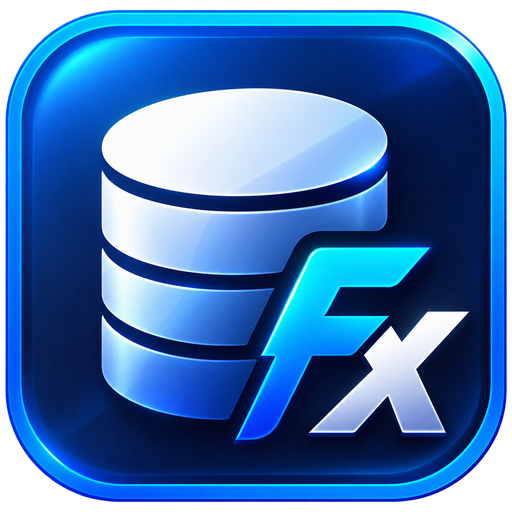
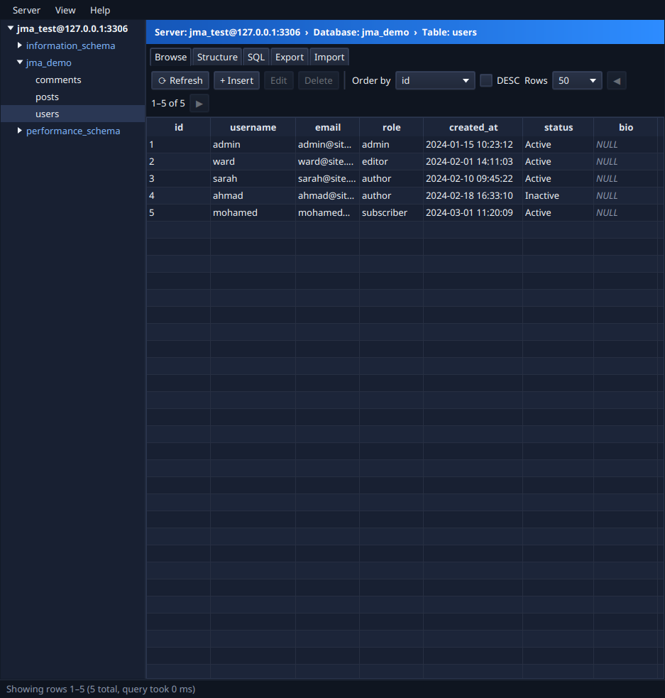
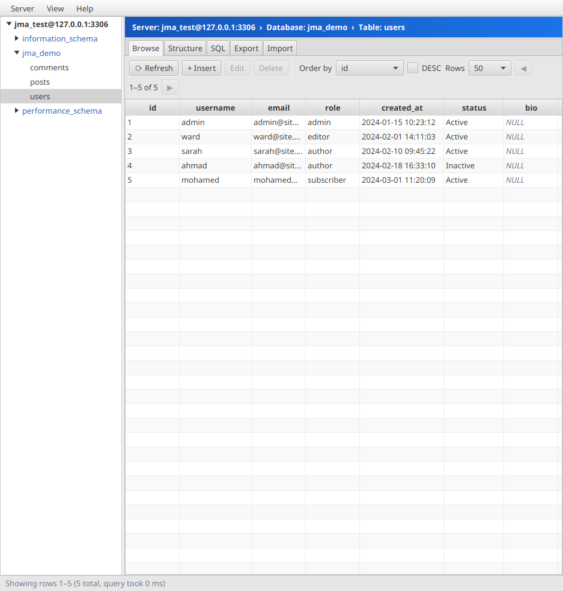
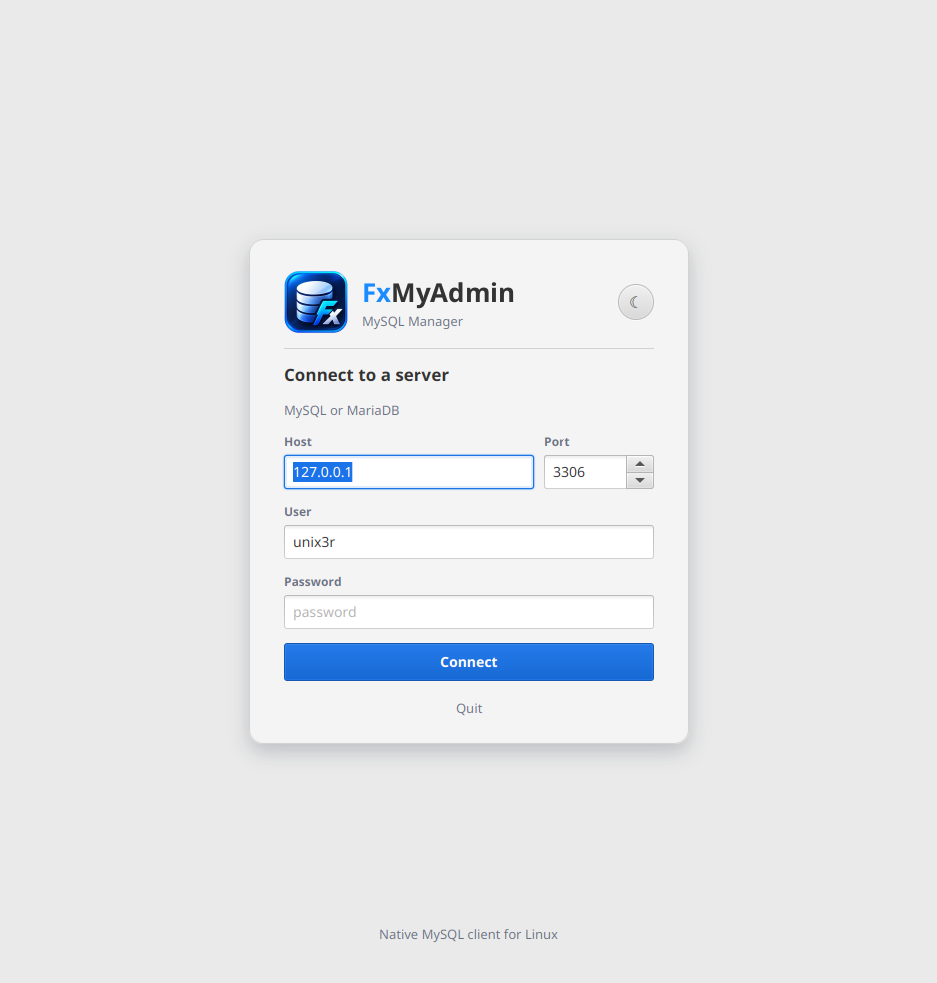
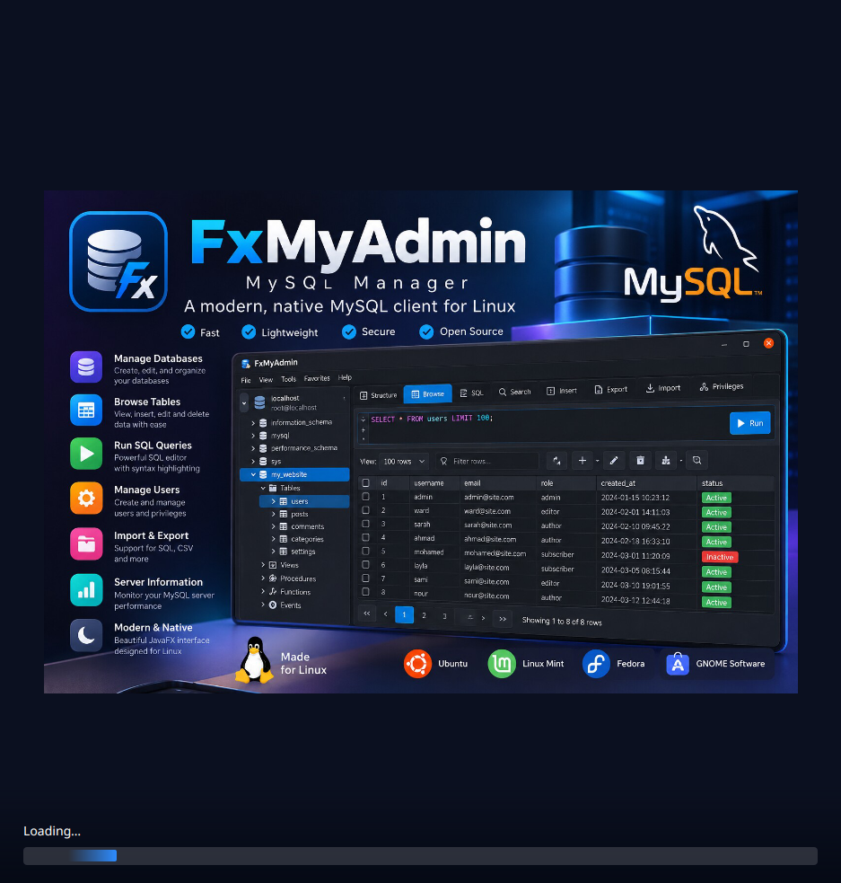

<p align="center">
  
</p>

<h1 align="center">FxMyAdmin</h1>

<p align="center">
  A modern, native MySQL &amp; MariaDB manager for Linux. No web server, no PHP, no browser.
</p>

**FxMyAdmin** is a free, open-source desktop app for managing MySQL and MariaDB databases on Linux.
It does the everyday work of phpMyAdmin without a web server, PHP, or a browser: install it like
any other Linux app and connect straight to your database server.

Built with Java 21, JavaFX 23 and MySQL Connector/J.

| Dark | Light |
|---|---|
|  |  |
|  |  |

## Features
- Loading screen, connect page, and light / dark themes (View → Theme, or Ctrl+Shift+L; "Follow system" by default)
- Connect page remembers host, port and user (never the password)
- Tree of databases, tables and views; create or drop databases and tables
- **Browse**: paged table data, ordering, and insert / edit / delete rows (double-click to edit, Del to delete)
- **Structure**: list, add and drop columns, view `SHOW CREATE TABLE`, truncate or drop tables
- **SQL**: run any SQL, including several statements at once (Ctrl+Enter runs the selection or everything)
- **Export**: SQL dump (structure and/or data, chosen tables) or CSV of one table
- **Import**: run a `.sql` / `.sql.gz` file into a database, with progress, cancel and error log.
  Handles comments, quoted semicolons and `DELIMITER` blocks. Server → Import (Ctrl+I) or right-click a database.

## Download

Grab the latest build from the [Releases](https://github.com/ahm3d/FxMyAdmin/releases) page:

- **Ubuntu / Debian / Mint:** `sudo apt install ./fxmyadmin_<version>_amd64.deb`
- **Any distro:** unpack `FxMyAdmin-<version>-linux-x64.tar.gz` and run `FxMyAdmin/bin/FxMyAdmin`

No Java installation needed; a trimmed Java runtime is bundled.

## Build the native app yourself
```bash
./build-native.sh                      # builds everything into dist/
sudo apt install ./dist/fxmyadmin_0.1.0_amd64.deb
```
Then start **FxMyAdmin** from your app menu, or run `/opt/fxmyadmin/bin/FxMyAdmin`.
Uninstall with `sudo apt remove fxmyadmin`.

`build-native.sh` produces:
| File | What it is |
|---|---|
| `dist/fxmyadmin_<ver>_amd64.deb` | Installer with menu entry and icon |
| `dist/FxMyAdmin-<ver>-linux-x64.tar.gz` | Portable app, unpack and run `FxMyAdmin/bin/FxMyAdmin` |
| `dist/FxMyAdmin/` | The same portable app, unpacked |

All of them bundle a trimmed Java runtime, so the target machine doesn't need Java.

## Develop
```bash
mvn javafx:run                         # run from source
mvn package && java -jar target/fxmyadmin.jar
```
Building needs JDK 21 (with jmods) and Maven: `sudo apt install openjdk-21-jdk maven`.

## Note on MySQL `root` on Ubuntu
On Ubuntu, `root` logs in through the Unix socket (`auth_socket`), so it can't log in with a password over TCP.
Create a user for the app:
```sql
sudo mysql
CREATE USER 'admin'@'localhost' IDENTIFIED BY 'your-password';
GRANT ALL PRIVILEGES ON *.* TO 'admin'@'localhost' WITH GRANT OPTION;
```

## Layout
```
src/main/java/com/javamyadmin/
  App.java, Launcher.java      startup: loading screen -> connect page -> main window
  db/                          JDBC layer (Database, SqlScriptReader, Sql quoting/literals, records)
  ui/                          JavaFX views and dialogs; Look.java = icons + light/dark theme
src/main/resources/com/javamyadmin/
  app.css, dark.css            light theme + dark overrides
  poster.jpg, icon*.png        branding
packaging/                     icon and .desktop template for jpackage
build-native.sh                native build (jlink + jpackage)
```

## Contributing
Issues and pull requests are welcome.

## License
[MIT](LICENSE)
